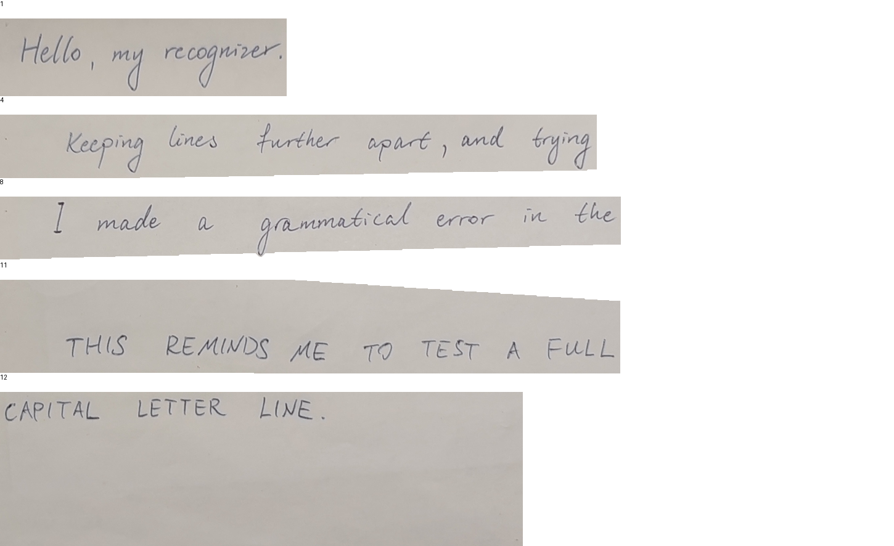

# Handwritten Note OCR

Turn a photo of handwritten English notes into a text file, one line at a time. The project combines a custom page splitter, Microsoft's pretrained TrOCR handwriting recognizer, and a local Qwen model that gives each note a title, subject and keywords.

**Why split the page?** When a word at the end of a sloping line dips toward the line below, a horizontal cut can slice through its letters. The splitter estimates a separate track for each line from the centers of ink groups. It searches for a boundary between neighboring tracks that crosses as little ink as possible, then crops the original image for recognition.



## Run a handwritten page

The repository includes [a handwritten page](Source/full_page_text1.png) with 15 lines, varying letter sizes and uneven spacing. From the repository root, set up the Python environment. On Windows PowerShell:

```powershell
py -m venv .venv
.\.venv\Scripts\python.exe -m pip install -r requirements.txt
```

The page workflow uses the Ollama application as a running local service. With Ollama installed and running, download the configured Qwen model and start the recognizer:

```powershell
ollama pull qwen3:4b-instruct
.\.venv\Scripts\python.exe src/start.py
```

Enter `full_page_text1.png` at the prompt. TrOCR downloads `microsoft/trocr-base-handwritten` on the first run. The program prints its prediction for each line. After Qwen analyzes the assembled text, it writes `Output/full_page_text1.txt` with the title, subject, keywords and transcription. Additional images go in `Source/`.

## Inspect the segmentation

Run `src/line_splitter.py` with the same Python interpreter and enter the image filename. Look in `Output/line_crops/` for a numbered crop from each line. The candidate preview in `Output/` shows the ink groups and highlights possible merges. This entry point only needs Pillow, NumPy and OpenCV.

## Evaluation

Run `src/evaluation.py` to compare predictions against reference text. Strict character error rate (CER) divides the number of insertions, deletions and substitutions by the reference length. Normalized CER first lowercases the text, removes ASCII punctuation and collapses whitespace. The script skips missing single-line samples and evaluates the two included handwritten pages separately. The script uses the original reference strings embedded in `src/evaluation.py`. The table below uses the later photo-checked transcriptions in `docs/evaluation/`. Differences such as the capital-letter lines on page 2 affect the scores.

The [development log](docs/development-log.md) records early results and design decisions. Small test samples, close line spacing and punctuation errors remain limitations. The source includes a placeholder for per-line margin trimming.

## Results on development samples

Scores below use the saved predictions from the 23 November local run. The two page references were checked against the photos, using conventional punctuation spacing and preserving capitalization and the original wording. [Reference and prediction files](docs/evaluation/) accompany the scores. These pages were used during development.

| Sample | Lines | Strict CER | Normalized CER |
|---|---:|---:|---:|
| Page 1 | 15 | 4.34% | 1.66% |
| Page 2 | 12 | 15.04% | 0.27% |

The same run reported mean CER across eight single-line samples of 10.86% strict and 3.57% normalized. Seven of eight matched after normalization.
